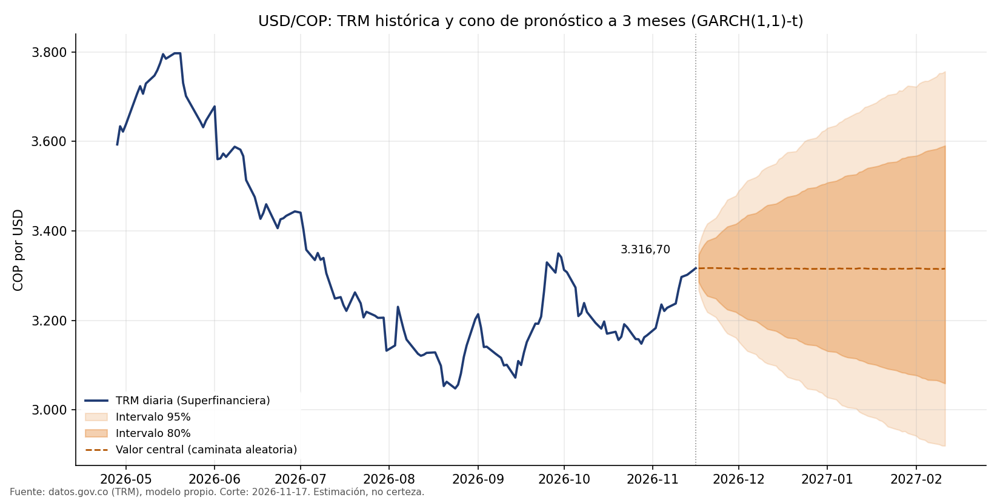
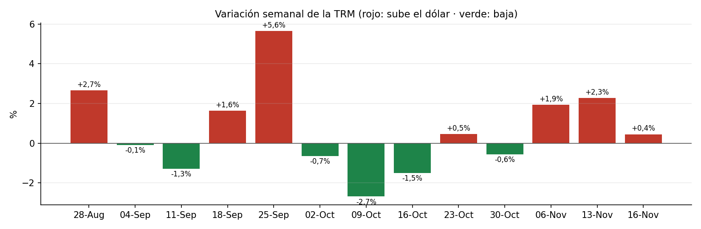

# 💵 USD/COP · Reporte del dólar en Colombia

> 🌐 **Web interactiva: https://jacoal1234-creator.github.io/usdcop-reporte/**
>
> Uso personal · Serie base: TRM oficial (Superfinanciera) · Actualizado: **2026-11-17**
> Análisis informativo y educativo. No es recomendación de inversión.

| TRM vigente | Variación | Rango 80% a 1 semana | Valor central usa | Error medio del backtest (12 sem.) |
|:---:|:---:|:---:|:---:|:---:|
| **$3.316,70** 2026-11-16 | ▲ **0,45%** vs 3.301,91 (2026-11-13) | **3.248 – 3.386** | caminata aleatoria | 56,7 COP |

## Resumen del último reporte
- **[H]** La TRM de hoy es **$3.316,70**. Rige desde el sábado 14 porque el lunes 16 fue festivo. Está +0,45% sobre la del viernes 13 ($3.301,91) y +4,7% sobre el mínimo del 28 de octubre ($3.148,02).
- **[H]** Hilamos tres semanas de alza por un petróleo que se desplomó (Brent de ~118 a ~93 USD) y un dólar global fuerte, porque el mercado da casi por hecha una **subida** de la Fed el 9 de diciembre.
- **[H]** Hoy el spot abrió a la baja ($3.307,85) y a las 10 a. m. el DANE publicó el PIB del tercer trimestre: **0,5% anual**, por debajo de todas las proyecciones.
- **[E]** **Para el viernes 20-nov**, el modelo da un valor central de $3.316,70, un rango al 80% de **$3.264 a $3.370**, un 41% de probabilidad de cerrar entre $3.295 y $3.338, y un 27% de tocar $3.350 en la semana. El detalle día a día está en la sección 4.0.
- **[O]** El sesgo de corto plazo es levemente alcista para el dólar mientras siga el impulso de la Fed. Pero la estacionalidad de fin de año y el consenso de analistas (~$3.250–3.280 a diciembre) apuntan a un retroceso en el mes.

➡️ **[Leer el reporte completo](reportes/2026-11-17_diario.md)**

## Histórico y cono de pronóstico

## Semana a semana

## Pronóstico del modelo
| Horizonte | Valor central | IC 80% | IC 95% | Prob. bajista / base / alcista del dólar |
|---|---|---|---|---|
| 1 semana | **3.316,70** | 3.248 – 3.386 | 3.206 – 3.429 | 29% / 41% / 29% |
| 4 semanas | **3.316,70** | 3.178 – 3.463 | 3.095 – 3.557 | 30% / 41% / 30% |
| 3 meses | **3.316,70** | 3.062 – 3.587 | 2.928 – 3.760 | 30% / 40% / 30% |

## Todos los reportes
| Fecha | Tipo | Archivos |
|---|---|---|
| 2026-11-17 | Diario | [abrir](reportes/2026-11-17_diario.md) · [Excel](reportes/2026-11-17_usdcop.xlsx) · [cono](reportes/2026-11-17_cono.png) |

---
Generado por `execution/build_readme.py`. Cómo regenerar: `python3 execution/fetch_data.py && python3 execution/model.py && python3 execution/build_outputs.py --etiqueta AAAA-MM-DD && python3 execution/build_readme.py --etiqueta AAAA-MM-DD`. Reglas del reporte: [directives/reporte_usdcop.md](directives/reporte_usdcop.md).
