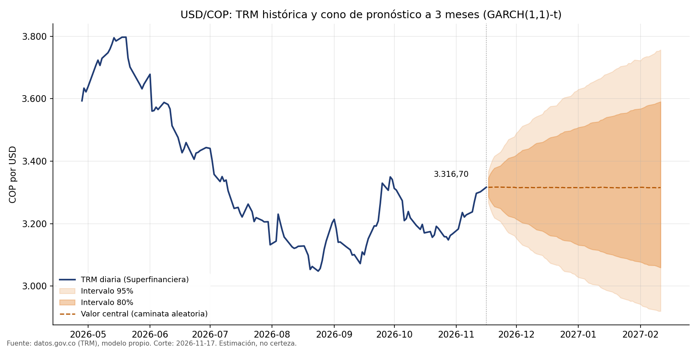

# USD/COP — Reporte diario · martes 17 de noviembre de 2026

> Etiquetas: **[H]** hecho con fuente · **[E]** estimación de un modelo o de un tercero · **[O]** opinión del analista.
> Corte de datos: 17-nov-2026, hacia el mediodía (hora de Colombia). La TRM del miércoles 18 se publica esta tarde y no está incluida.

## 1. Resumen ejecutivo
- **[H]** La TRM de hoy es **$3.316,70**. Rige desde el sábado 14 porque el lunes 16 fue festivo. Está +0,45% sobre la del viernes 13 ($3.301,91) y +4,7% sobre el mínimo del 28 de octubre ($3.148,02).
- **[H]** Hilamos tres semanas de alza por un petróleo que se desplomó (Brent de ~118 a ~93 USD) y un dólar global fuerte, porque el mercado da casi por hecha una **subida** de la Fed el 9 de diciembre.
- **[H]** Hoy el spot abrió a la baja ($3.307,85) y a las 10 a. m. el DANE publicó el PIB del tercer trimestre: **0,5% anual**, por debajo de todas las proyecciones.
- **[E]** **Para el viernes 20-nov**, el modelo da un valor central de $3.316,70, un rango al 80% de **$3.264 a $3.370**, un 41% de probabilidad de cerrar entre $3.295 y $3.338, y un 27% de tocar $3.350 en la semana. El detalle día a día está en la sección 4.0.
- **[O]** El sesgo de corto plazo es levemente alcista para el dólar mientras siga el impulso de la Fed. Pero la estacionalidad de fin de año y el consenso de analistas (~$3.250–3.280 a diciembre) apuntan a un retroceso en el mes.

## 2. Comportamiento reciente

### 2.1 Hoy
| Dato | Valor | Tipo |
|---|---|---|
| TRM vigente 17-nov | $3.316,70 | [H] Superfinanciera, vía datos.gov.co |
| TRM anterior (13-nov) | $3.301,91 | [H] ídem |
| Variación | +14,79 COP (+0,45%) | [H] cálculo propio |
| Apertura spot 17-nov | $3.307,85; rango inicial $3.302 – $3.315; 61 operaciones por USD 22,4 millones | [H] El Universal |
| Spot ~11:05 a. m. | ~$3.308 | [H] Wilkinson (monitor en vivo) |
| DXY (Yahoo, 17-nov) | 103,42 (16-nov: 103,55) | [H] Yahoo Finance |
| Brent (BZ=F, 17-nov) | 93,23 USD (16-nov: 92,44) | [H] Yahoo Finance |
| Tesoro EE. UU. 10 años | 5,10% | [H] Yahoo Finance (^TNX) |

**Por qué se mueve hoy:**
- **[H]** El spot abre por debajo de la TRM: hay una pausa tras varios días de alzas, y el dólar global retrocede un poco (DXY 103,55 → 103,42).
- **[H]** Según El Universal, en FedWatch más del 93% de las apuestas espera un alza de 25 pb el 9 de diciembre. La probabilidad de un alza de 50 pb bajó del 14,5% al 2,6%, y eso le quita algo de impulso al dólar.
- **[H]** El PIB del tercer trimestre creció 0,5% anual y cayó 0,8% frente al trimestre anterior (serie desestacionalizada), según el DANE citado por El Tiempo, Infobae y La FM. Bancolombia esperaba 1,8%.
- **[O]** Una economía más débil le da argumentos a la Junta del BanRep para no subir tasas en diciembre. Eso puede restarle algo de atractivo al carry del peso, aunque el efecto de un dato de PIB sobre el tipo de cambio suele ser pequeño frente al de la Fed y el petróleo.

### 2.2 Últimas 12 semanas (TRM, lunes a viernes)
Apertura, cierre, máximo y mínimo son la primera, última, mayor y menor TRM de la semana. La volatilidad es la desviación estándar de los retornos diarios dentro de la semana.

| Semana | Días | Apertura | Cierre | Máximo | Mínimo | Var. % | Volat. diaria % | TRM prom. |
|---|---|---|---|---|---|---|---|---|
| 24 a 28 ago | 5 | 3.048,12 | 3.144,28 | 3.144,28 | 3.048,12 | 2,65 | 0,65 | 3.089,76 |
| 31 ago a 4 sep | 5 | 3.202,79 | 3.141,36 | 3.213,97 | 3.140,55 | -0,09 | 1,25 | 3.176,53 |
| 7 a 11 sep | 4 | 3.126,08 | 3.101,00 | 3.126,08 | 3.099,48 | -1,28 | 0,27 | 3.110,76 |
| 14 a 18 sep | 5 | 3.072,27 | 3.151,73 | 3.151,73 | 3.072,27 | 1,64 | 0,90 | 3.112,44 |
| 21 a 25 sep | 5 | 3.192,92 | 3.329,61 | 3.329,61 | 3.192,53 | **5,64** | 0,84 | 3.237,62 |
| 28 sep a 2 oct | 5 | 3.306,86 | 3.307,73 | 3.349,63 | 3.306,86 | -0,66 | 0,84 | 3.323,66 |
| 5 a 9 oct | 5 | 3.273,49 | 3.218,75 | 3.273,49 | 3.209,78 | -2,69 | 1,05 | 3.231,38 |
| 12 a 16 oct | 4 | 3.194,44 | 3.170,46 | 3.197,65 | 3.170,46 | -1,50 | 0,62 | 3.186,07 |
| 19 a 23 oct | 5 | 3.174,67 | 3.185,01 | 3.191,47 | 3.156,32 | 0,46 | 0,54 | 3.174,25 |
| 26 a 30 oct | 5 | 3.158,43 | 3.166,91 | 3.166,91 | 3.148,02 | -0,57 | 0,49 | 3.158,73 |
| 2 a 6 nov | 4 | 3.182,99 | 3.228,26 | 3.235,59 | 3.182,99 | 1,94 | 0,87 | 3.217,01 |
| 9 a 13 nov | 4 | 3.237,83 | 3.301,91 | 3.301,91 | 3.237,83 | 2,28 | 0,41 | 3.276,67 |
| 16 a 20 nov (en curso) | 1 | 3.316,70 | 3.316,70 | 3.316,70 | 3.316,70 | 0,45 | n/d | 3.316,70 |

Fuente: TRM de la Superfinanciera (datos.gov.co, recurso 32sa-8pi3); cálculos propios en `execution/model.py`.

**Lectura del periodo:**
- **[H] Rango típico:** en las 12 semanas completas, la variación semanal absoluta promedio fue de 1,8% y el rango semanal medio (máximo/mínimo) de 1,9%.
- **[H] Semanas atípicas:**
  - La del 21 al 25 de septiembre (+5,64%) es la más grande del periodo. *Todavía no investigué su causa; queda para el reporte semanal del viernes.*
  - La del 5 al 9 de octubre (-2,69%) también se sale del rango típico.
- **[E] Tendencia:** desde el mínimo del 28-oct ($3.148) la TRM sube cerca de 5% en tres semanas y vuelve a la zona del máximo del periodo ($3.349,63, en la semana del 28-sep al 2-oct).
- **Soportes y resistencias [O]:**
  - Resistencia: $3.330–3.350 (máximos de finales de septiembre y comienzos de octubre).
  - Soportes: $3.270 (Visión Davivienda también lo marca) y $3.200. Por debajo, $3.150–3.170, la zona de mínimos de octubre.

**Motivos de las dos últimas semanas:**
- **2 a 6 nov (+1,94%):**
  - **[H] Petróleo:** el Brent se desplomó con los avances hacia un acuerdo entre EE. UU. e Irán. Cayó cerca de 16% en la semana según Reuters, citado por Infobae, y en Yahoo pasó de 117,64 (30-oct) a 98,32 (6-nov).
  - **[H] Compra de dólares del BanRep:** el 6-nov el Banco compró **USD 2.000 millones** al Gobierno para sus reservas (comunicado del BanRep). Según Global66, el mercado lo leyó como menos oferta de dólares.
  - **[H] Elecciones en EE. UU.:** las elecciones de mitad de mandato también movieron el mercado (GBM y Portafolio).
- **9 a 13 nov (+2,28%):**
  - **[H] Fed y DXY:** el IPC de octubre en EE. UU. subió 0,4% mensual frente a 0,3% esperado. La probabilidad de un **alza** de la Fed en diciembre pasó de ~78% a más de 85%, y el DXY tocó 103,17 (Infobae, 15-nov).
  - **[H] Petróleo:** el Brent cedió otro ~3%.
  - **[H] Inflación en Colombia:** la de octubre fue de 6,30% anual, menor que la esperada (Reuters esperaba 6,38%). Eso le baja la probabilidad a un alza del BanRep.
  - **[E] Lo que dice la regresión:** el alza del Tesoro a 10 años (+29 pb en la semana) y el DXY explican cerca de 1,3 puntos del +2,3%. El resto queda sin explicar por las variables del modelo.

## 3. Pronóstico fundamental

### 3.1 Qué proyectan otros (consenso)
| Fuente | Proyección | Horizonte | Fecha de la nota | Tipo |
|---|---|---|---|---|
| Global66 (D. Londoño) | $3.270 – $3.360 | Semana 16–20 nov | 15-nov | [E] |
| Visión Davivienda (S. Martínez) | ~$3.276; noviembre entre $3.120 y $3.436 (promedio ~$3.263) | Cierre 2026 | 14-nov | [E] |
| Encuesta de expectativas del BanRep | $3.258 | Cierre 2026 | octubre (citada por Valora Analitik) | [E] |
| Encuesta Fedesarrollo–BVC | $3.240 (antes $3.300) | Cierre 2026 | octubre | [E] |
| Credicorp / BBVA Research / Latinfocus | ~$3.250 / $3.265 / $3.351 | Cierre 2026 | octubre | [E] |
| BofA y Banco de Occidente | ~$3.150 | Cierre 2026 | octubre | [E] |
| BTG Pactual | $3.460 | Cierre 2026 | octubre | [E] |
| Grupo Cibest | $3.400 – $3.650 | Cierre 2026 | octubre | [E] |
| Bancolombia | $3.120 – $3.300 | Noviembre | fin de octubre | [E] |

- **Consenso [E]:** la mediana de las proyecciones de cierre de año está alrededor de **$3.260**, con una dispersión amplia, de ~$3.150 a ~$3.650.
- **[O]** La mayoría de esas cifras son de octubre, antes del desplome del Brent y del giro de la Fed hacia subir tasas. Es probable que las próximas revisiones suban.

**Factores que sostienen un dólar más bajo:**
- **[H]** Según Corfi (Mauricio Acevedo, citado por Infobae), en los últimos 11 años el dólar bajó en noviembre o diciembre, por la monetización de fin de año: petróleo, remesas, café y necesidades fiscales.
- **[H]** El diferencial de tasas sigue siendo alto: BanRep 12,25% frente a Fed 3,75%–4,00%, unos 8,4 puntos.
- **[H]** El Gobierno anunció avances hacia USD 25.900 millones en inversión privada (El Universal, 17-nov).

**Factores que sostienen un dólar más alto:**
- Una Fed que **sube** tasas, lo que reduce el carry.
- El Brent en ~93 USD, frente a 110–118 USD en octubre.
- El trámite del proyecto de "rescate económico" o reforma tributaria. Un ajuste de ~$45 billones bajaría la prima fiscal; eliminar impuestos sin recortes la subiría.
- La negociación del salario mínimo 2027: los trabajadores piden más de 35% y los empresarios menos de 10%.
- El PIB débil de hoy.

### 3.2 Calendario de las próximas 4 semanas
| Fecha | Evento | Por qué importa | Fuente |
|---|---|---|---|
| 17-nov (hoy) | PIB del tercer trimestre de Colombia: 0,5% anual (ya publicado) | Crecimiento, postura del BanRep | DANE, El Tiempo |
| Esta semana | Minutas de la Fed | Confirmar el sesgo de subir tasas | Infobae 15-nov |
| 18-nov | Inicia la concertación del salario mínimo 2027 | Inflación futura y riesgo fiscal | Infobae 15-nov |
| Nov–dic | Trámite del proyecto de rescate o reforma tributaria (~30 días en el Congreso) | Prima de riesgo fiscal | Infobae 15-nov |
| 29-nov | Reunión ministerial de la OPEP+ (marco de producción 2027) | Brent | OPEP, Engineering News |
| 30-nov | Junta del BanRep, reunión ordinaria **sin** decisión de tasas | — | BanRep |
| 4-dic | Empleo de EE. UU. (noviembre) | Fed y DXY | BLS |
| 8–9-dic | Reunión de la Fed; decisión el 9-dic a las 2 p. m. ET, con proyecciones (SEP) | **Evento principal**: se espera un alza de 25 pb | Fed y calendarios |
| ~10-dic | IPC de EE. UU. de noviembre (fecha de un tercero; el BLS no la confirma) | Fed | financecalendar.com |
| 18-dic (fuera de la ventana de 4 semanas) | Decisión de tasas del BanRep; silencio del 12 al 18-dic | Diferencial de tasas | BanRep |

## 4. Predicción cuantitativa (modelo propio)

### 4.0 Pronóstico de esta semana, día a día hasta el viernes 20-nov
> Actualizado el 17-nov a las 12:30 p. m. Sale de `execution/pronostico_semana.py`: 50.000 trayectorias diarias del GARCH(1,1)-t con semilla 42, partiendo de la TRM vigente de $3.316,70.
> Recuerda: la TRM de cada día se calcula con las operaciones del día hábil anterior. La TRM del viernes 20 sale de lo que se negocie el jueves 19.

| TRM del día | Valor central [E] | 50% probable [E] | IC 80% [E] | IC 95% [E] | Prob. de quedar arriba de 3.316,70 [E] |
|---|---|---|---|---|---|
| Miércoles 18-nov | 3.316,70 | 3.301 – 3.332 | 3.286 – 3.347 | 3.268 – 3.367 | 50% |
| Jueves 19-nov | 3.316,70 | 3.295 – 3.339 | 3.274 – 3.360 | 3.248 – 3.388 | 50% |
| **Viernes 20-nov (cierre de la semana)** | **3.316,70** | **3.290 – 3.344** | **3.264 – 3.370** | **3.232 – 3.404** | 50% |
| Sáb 21 a lun 23 (sale de las operaciones del viernes) | 3.316,70 | 3.285 – 3.348 | 3.256 – 3.379 | 3.220 – 3.418 | 50% |

**Escenarios para la TRM del viernes 20-nov:**

| Escenario | Rango | Prob. modelo [E] | Prob. ajustada [O] | Qué tendría que pasar |
|---|---|---|---|---|
| Bajista del dólar | < 3.295 | 30% | 30% | Toma de utilidades tras tres semanas de alza; DXY por debajo de 103; Brent rebota; minutas de la Fed sin sorpresas |
| Base | 3.295 – 3.338 | 41% | 45% | Consolidación bajo la resistencia de ~$3.350 a la espera de la Fed del 9-dic |
| Alcista del dólar | > 3.338 | 29% | 25% | Minutas de la Fed más duras, DXY por encima de 104, nueva caída del Brent o ruido por el salario mínimo o la reforma |

**¿Toca algún nivel clave antes del viernes?** Probabilidad de que alguna TRM entre el 18 y el 20 lo alcance [E]:
- Sube a $3.350 (resistencia): **27%**
- Baja a $3.270 (soporte): **16%**
- Sube a $3.400: 3%
- Baja a $3.200: menos del 1%

En la trayectoria típica, la TRM se mueve en la semana entre **~$3.303 y ~$3.330** (mediana del mínimo y del máximo simulados).

**Lo que ya se ve hoy:**
- **[H]** El spot de hoy, que forma la TRM del miércoles, va en ~$3.311 a las 12:31 p. m., con un rango intradía de $3.293,5 a $3.328,5, según Yahoo Finance `COP=X`. Es una cotización indicativa, no la del SET-FX.
- **[O]** Si la sesión cierra así, la TRM del miércoles 18 quedaría un poco por debajo de la actual, cerca de **$3.305–3.315**: dentro del rango central del modelo.
- **[O]** El sesgo de la semana no es claro. El impulso de la Fed y el DXY empuja hacia arriba; la pausa después de tres semanas de alza y el PIB débil (menos razones para que el BanRep suba tasas) no dan una dirección clara. Por eso le doy un poco más de peso al escenario base que el modelo.

**Especificación:**
- **Valor central:** el ARIMA(2,0,0) sobre retornos diarios **no** le ganó a la caminata aleatoria en el backtest (MAE 57,5 frente a 56,7 COP). Por eso el valor central es la **TRM actual**. **[O]** No es falta de modelo; es lo honesto: en divisas, la caminata aleatoria es muy difícil de superar a corto plazo.
- **Intervalos:** salen de un GARCH(1,1) con innovaciones t de Student (ν ≈ 9,9), estimado con 3 años de TRM diaria. Volatilidad diaria actual: **0,75%**; volatilidad de largo plazo del modelo: 0,83%. Se hicieron 20.000 simulaciones con semilla 42.
- **Regresión explicativa** (semanal, 202 semanas, errores HAC):

  ΔTRM% = −0,22 + 0,30·ΔDXY% − 0,08·ΔBrent% + 0,032·ΔUST10(pb)

  - El Brent es significativo (p = 0,009); el DXY (p = 0,14) y el Tesoro (p = 0,06) no lo son al 5%.
  - El **R² es de 0,09**: estas tres variables explican poco del movimiento semanal. Lo uso para traducir escenarios, no para pronosticar.

| Horizonte | Fecha aprox. | Valor central [E] | IC 80% [E] | IC 95% [E] |
|---|---|---|---|---|
| 1 semana | 24-nov | 3.316,70 | 3.248 – 3.386 | 3.206 – 3.429 |
| 4 semanas | 15-dic | 3.316,70 | 3.178 – 3.463 | 3.095 – 3.557 |
| 3 meses | mediados de feb-2027 | 3.316,70 | 3.062 – 3.587 | 2.928 – 3.760 |

**Escenarios.** La probabilidad sale del modelo y la banda base es el valor central ± 0,5 desviaciones estándar. El modelo no tiene sesgo direccional, así que es simétrico. Al lado va una probabilidad ajustada con criterio.

| Horizonte | Escenario | Rango | Prob. modelo [E] | Prob. ajustada [O] | Qué tendría que pasar |
|---|---|---|---|---|---|
| 1 semana | Bajista del dólar | < 3.289 | 29% | 30% | Corrección técnica tras 3 semanas de alza; DXY por debajo de 103; Brent rebota hacia 98–100 |
| | Base | 3.289 – 3.345 | 41% | 45% | Consolidación cerca de la resistencia de $3.330–3.350 a la espera de la Fed |
| | Alcista del dólar | > 3.345 | 29% | 25% | Minutas de la Fed duras, DXY por encima de 104, nuevo tropiezo del Brent o ruido fiscal o salarial |
| 4 semanas | Bajista del dólar | < 3.259 | 30% | 35% | Monetización de fin de año; la Fed sube pero señala pausa; avanza la reforma con un ajuste creíble |
| | Base | 3.259 – 3.375 | 41% | 40% | La Fed sube 25 pb como se espera, Brent estable en 90–95, sin sorpresas fiscales |
| | Alcista del dólar | > 3.375 | 30% | 25% | Fed más dura (50 pb o señal de más alzas), la OPEP+ el 29-nov sube la oferta para 2027, la reforma se diluye |
| 3 meses | Bajista del dólar | < 3.213 | 30% | 30% | El Brent se recupera, la Fed hace pausa, fluyen los USD 25.900 millones de inversión anunciados |
| | Base | 3.213 – 3.423 | 40% | 40% | El diferencial de tasas sostiene el carry, con choques que se compensan |
| | Alcista del dólar | > 3.423 | 30% | 30% | Deterioro fiscal, ciclo de alzas de la Fed, o el BanRep empieza a recortar por el PIB débil |

**Traducción por la regresión [E]:**
- Un Brent 10% más bajo equivale a +0,8% en la TRM (~+27 COP).
- Un DXY 2% más alto equivale a +0,6% (~+20 COP).
- Un Tesoro 25 pb más alto equivale a +0,8% (~+27 COP).
- Como el R² es bajo, son órdenes de magnitud, no reglas.

### Backtesting (últimas 12 semanas completas)
Cada viernes se re-estimó el modelo solo con los datos disponibles ese día y se pronosticó el cierre de la semana siguiente.

| Semana pronosticada (cierre) | TRM corte | ARIMA | Caminata | Real | Error ARIMA | Error caminata | Acierto dirección ARIMA |
|---|---|---|---|---|---|---|---|
| 28-ago | 3.062,96 | 3.061,74 | 3.062,96 | 3.144,28 | -82,5 | -81,3 | No |
| 04-sep | 3.144,28 | 3.131,06 | 3.144,28 | 3.141,36 | -10,3 | 2,9 | Sí |
| 11-sep | 3.141,36 | 3.141,47 | 3.141,36 | 3.101,00 | 40,5 | 40,4 | No |
| 18-sep | 3.101,00 | 3.095,47 | 3.101,00 | 3.151,73 | -56,3 | -50,7 | No |
| 25-sep | 3.151,73 | 3.140,33 | 3.151,73 | 3.329,61 | -189,3 | -177,9 | No |
| 02-oct | 3.329,61 | 3.316,95 | 3.329,61 | 3.307,73 | 9,2 | 21,9 | Sí |
| 09-oct | 3.307,73 | 3.304,22 | 3.307,73 | 3.218,75 | 85,5 | 89,0 | Sí |
| 16-oct | 3.218,75 | 3.208,74 | 3.218,75 | 3.170,46 | 38,3 | 48,3 | Sí |
| 23-oct | 3.170,46 | 3.159,39 | 3.170,46 | 3.185,01 | -25,6 | -14,6 | No |
| 30-oct | 3.185,01 | 3.173,22 | 3.185,01 | 3.166,91 | 6,3 | 18,1 | Sí |
| 06-nov | 3.166,91 | 3.158,91 | 3.166,91 | 3.228,26 | -69,4 | -61,4 | No |
| 13-nov | 3.228,26 | 3.224,58 | 3.228,26 | 3.301,91 | -77,3 | -73,6 | No |

| Métrica | ARIMA | Caminata aleatoria |
|---|---|---|
| Error absoluto medio (MAE) | 57,5 COP | 56,7 COP |
| MAPE | 1,78% | 1,75% |
| Sesgo medio | -27,6 COP (subestima) | — |
| Acierto de dirección | 41,7% (5 de 12) | no aplica |

- **[O]** El ARIMA trae una deriva negativa aprendida del 2026 bajista y por eso siempre pronosticó bajada. Su "acierto de dirección" es básicamente la proporción de semanas en que la TRM cayó, no habilidad del modelo.
- Ningún modelo anticipó el salto del 25-sep (error de ~180 COP). Es un recordatorio de que los intervalos importan más que el valor central.

## 5. Lectura para decisiones y riesgos
Esto es general: explica cómo leer el panorama, no qué hacer con dinero propio.

**Importador** (necesita comprar dólares):
- El dólar está en la parte alta de su rango de los últimos 3 meses ($3.048–3.350), y cerca de una resistencia.
- El consenso de analistas espera un cierre de año más bajo que el nivel actual. Pero el evento de la Fed del 9-dic puede empujar al alza antes.
- **Cómo se suele manejar esto:**
  - Escalonar las compras en varias fechas para no depender de un solo día.
  - Usar forwards para fijar parte de los pagos con fecha conocida, en especial los que caen alrededor del 9-dic.
  - Revisar el costo del forward: con un diferencial de tasas de ~8,4 puntos, el forward a 1 mes queda cerca de **0,7% por encima del spot**. Esto es aritmética de paridad de tasas: (12,25% − 3,9%)/12.

**Exportador** (vende dólares):
- Los niveles actuales son mejores que los de octubre. El riesgo es que la estacionalidad de fin de año y una Fed que haga pausa devuelvan la TRM hacia $3.200–3.250.
- **Cómo se suele manejar esto:**
  - Vender por tramos.
  - Usar forwards de venta: el punto forward juega a favor del exportador porque recibe esa prima de ~0,7% mensual.
  - Usar opciones (put USD) si quiere proteger un piso sin renunciar a un alza.

**Riesgos que invalidarían este análisis:**
1. Un choque geopolítico en Medio Oriente que revierta la caída del Brent, o una ruptura del acuerdo EE. UU.–Irán. Movería el petróleo con fuerza en cualquier dirección.
2. Una Fed que sorprenda (50 pb o una pausa). El mercado da ~93% a un alza de 25 pb.
3. Ruido fiscal o político en Colombia: la reforma se diluye, una rebaja de calificación o el salario mínimo muy por encima de la inflación.
4. Un cambio de régimen de volatilidad. El GARCH se estimó con 3 años; un choque grande lo invalida hasta re-estimar.
5. **Limitaciones del modelo:** no incluye la prima de riesgo de Colombia (CDS/EMBI, sin fuente gratuita) ni el diferencial con los TES. La regresión explica menos del 10% del movimiento semanal.

> **Aviso:** este documento es un análisis informativo y educativo. No es una recomendación de inversión, ni de compra o venta de divisas, ni asesoría financiera personalizada.

## 6. Fuentes (consultadas el 17-nov-2026)
- TRM oficial (Superfinanciera), API de datos.gov.co: https://www.datos.gov.co/resource/32sa-8pi3.json
- DXY, Brent y Tesoro a 10 años: Yahoo Finance — https://finance.yahoo.com/quote/DX-Y.NYB · https://finance.yahoo.com/quote/BZ=F · https://finance.yahoo.com/quote/%5ETNX
- Apertura del 17-nov y FedWatch: El Universal — https://www.eluniversal.com.co/economica/2026/11/17/dolar-en-colombia-abre-a-la-baja-tras-varios-dias-de-fuertes-alzas-este-es-el-precio/
- PIB del tercer trimestre de 2026: El Tiempo — https://www.eltiempo.com/economia/sectores/el-pib-de-colombia-crecio-0-5-en-el-tercer-trimestre-informo-el-dane-3601589 · Infobae — https://www.infobae.com/colombia/2026/11/17/se-estanco-la-economia-de-colombia-crecio-05-en-el-tercer-trimestre-muy-por-debajo-del-resultado-del-2025/
- Calendario del DANE 2026: https://www.dane.gov.co/files/prensa/comunicados/cp-CalendarioPublicaciones2026.pdf
- Agenda de la semana, Fed, petróleo y salario mínimo: Infobae (15-nov) — https://www.infobae.com/colombia/2026/11/15/precio-del-dolar-en-colombia-que-pasara-con-la-moneda-durante-la-concertacion-del-aumento-del-salario-minimo-de-2027/
- Visión Davivienda y estacionalidad (Corfi): Infobae (14-nov) — https://www.infobae.com/colombia/2026/11/14/el-dolar-podria-llegar-a-costar-mas-de-3400-para-el-cierre-de-2026-segun-informe/
- Proyecciones de cierre de 2026: Valora Analitik — https://www.valoraanalitik.com/dolar-en-colombia-proyecciones-de-precio-para-el-cierre-de-2026-y-senales-para-quienes-quieren-comprar/ · Infobae (27-oct) — https://www.infobae.com/colombia/2026/10/27/dolar-podria-repuntar-al-cierre-de-2026-analistas-ven-precios-entre-3250-y-3300-para-diciembre/ · Diario del Huila — https://diariodelhuila.com/proyeccion-dolar-colombia-2026/
- Compra de USD 2.000 millones del BanRep: https://banrep.gov.co/es/noticias/junta-directiva/banrep-compro-2000-millones-dolares-nov-2026
- Global66, análisis semanal (6-nov): https://www.global66.com/blog/dolar-hoy-colombia-analisis-semanal-06-noviembre-2026/
- Tasa del BanRep en 12,25%: Portafolio — https://www.portafolio.co/economia/banco-de-la-republica-mantiene-la-tasa-en-12-25-con-voto-dividido-505819
- Reuniones de la Junta del BanRep (30-nov y 18-dic): https://www.banrep.gov.co/es/noticias/calendario-actividades-junta-directiva/reunion-noviembre-2026
- Inflación de octubre de 2026 (6,30%): El País — https://www.elpais.com.co/economia/inflacion-en-colombia-se-situo-en-630-anual-al-mes-de-octubre-el-dato-tuvo-una-leve-alza-0909.html
- Petróleo y la caída tras las elecciones en EE. UU.: GBM — https://gbm.com/media/noticia/el-crudo-se-encamina-a-una-fuerte-caida-semanal-tras-elecciones-medio-mandato-en-eeuu/ · Emol (2-nov) — https://www.emol.com/noticias/Economia/2026/11/02/1215845/petroleo-baja-acercamientos-medio-oriente.html
- OPEP+ (reunión del 29-nov): https://www.opec.org/pr-detail/2033620-1-november-2026.html · https://engineeringnews.co.za/article/opec-keeps-december-oil-output-targets-steady-ahead-of-tougher-call-for-2027-2026-11-02
- Spot en vivo (~11:05 a. m.): https://dolar.wilkinsonpc.com.co/dolar-hoy-spot-minuto-a-minuto/
- Dólar tras las elecciones de mitad de mandato en EE. UU.: Portafolio — https://www.portafolio.co/economia/finanzas/el-dolar-en-colombia-pego-un-salto-asi-cotiza-la-divisa-tras-las-elecciones-de-medio-tiempo-en-estados-unidos-505683
- Empleo de EE. UU. el 4-dic: BLS — https://www.bls.gov/schedule/2026/12_sched_list.htm
- Fecha de la Fed del 9-dic: https://www.financecalendar.com/event/fomc-rate-decision-december-2026/
- Modelo, backtest y Excel: `execution/model.py`, `execution/build_outputs.py`, `reportes/2026-11-17_usdcop.xlsx`
